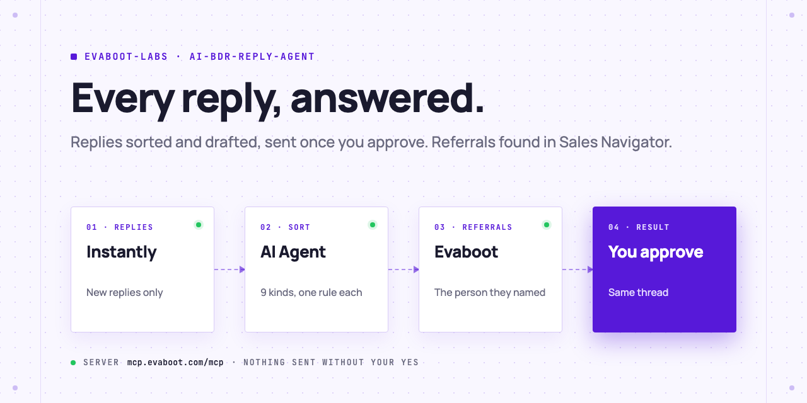
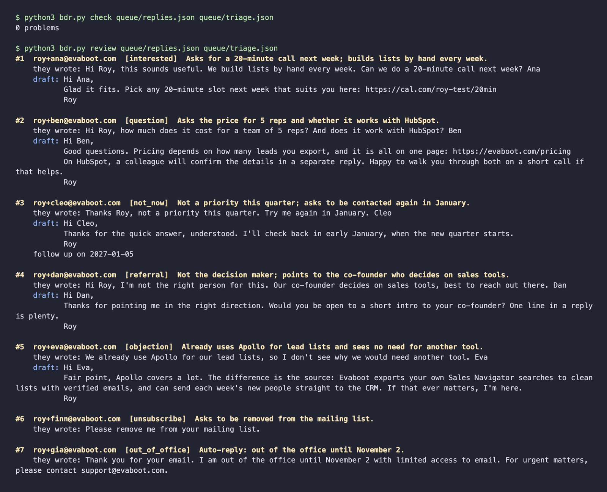
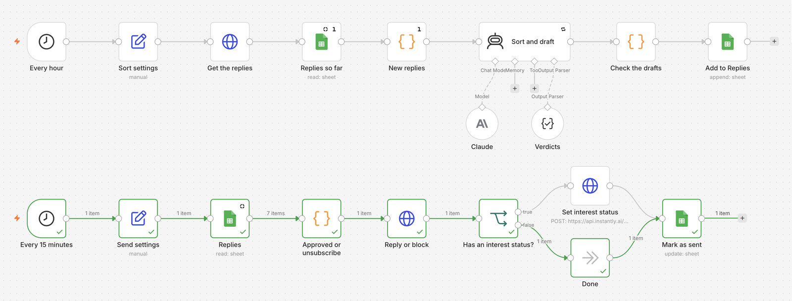

<picture>
  <source media="(prefers-color-scheme: dark)" srcset=".github/assets/banner-dark.png">
  
</picture>

# AI BDR reply agent

The other half of a BDR's day: the replies. Your AI Agent reads each reply to your Instantly campaign, sorts it (interested, question, not now, referral, objection, unsubscribe, out of office), drafts the answer from your playbook, and finds the person a referral points to with Evaboot. Nothing is sent until you approve it.

[](AGENTS.md)
[](https://evaboot.com/mcp)
[](LICENSE)

## Set it up in one prompt

Paste this into Claude Code, Codex or Cursor:

```text
Clone https://github.com/evaboot-labs/ai-bdr-reply-agent, read AGENTS.md and follow the skill. Answer today's replies on my Instantly campaign, and show me every draft before you send anything.
```

<details>
<summary>Or install the skill</summary>

Claude Code:

```text
/plugin marketplace add evaboot-labs/ai-bdr-reply-agent
/plugin install ai-bdr-reply-agent@evaboot-labs-ai-bdr-reply-agent
```

Codex, Cursor and other agents:

```bash
npx skills add evaboot-labs/ai-bdr-reply-agent
```

</details>

## How it works

**1. Only new replies, without the quoted email.** `bdr.py replies` reads your campaign's replies from Instantly and skips the ones already handled.

**2. One category, one rule.** Your agent sorts each reply and drafts the answer from [`PLAYBOOK.md`](PLAYBOOK.md): the booking link for a yes, the pricing page for a price question, a date for "not now", no reply at all for an unsubscribe or an auto-reply. `bdr.py check` rejects a missing booking link, a price the playbook does not hold, or a draft where none belongs.



**3. Referrals become leads.** When a reply says "talk to our co-founder", the agent finds the company in Sales Navigator through Evaboot, reads its people and names the right one.

**4. You approve, it sends.** `bdr.py send --approve 1,3 --send` answers in the same thread, from the same mailbox, and sets each lead's interest status. Unsubscribes go to your block list without a reply. Every handled reply is logged, with its follow-up date or referred person.

**5. Or run it in n8n.** Every hour, Claude sorts and drafts into a Google Sheet; write `yes` in the Send column, and it goes out within 15 minutes.



## What you need

- An [Instantly](https://instantly.ai) campaign and an API v2 key.
- An AI Agent that can use an MCP server: Claude Code, Codex, Cursor, or the n8n version.
- For referrals: an [Evaboot account](https://dash.evaboot.com/accounts/signup/?last_click_origin=ai-bdr-reply-agent-repo) and a Sales Navigator seat. Previews are free; an email lookup costs 1 credit.
- Python 3.9+, with no packages to install.

## Go further

| Page | For |
|---|---|
| [docs/connect-your-agent.md](docs/connect-your-agent.md) | The setup by hand, for each agent |
| [docs/n8n.md](docs/n8n.md) | The same agent in n8n, with a Google Sheet to approve from |
| [PLAYBOOK.md](PLAYBOOK.md) | Your facts, and the rule for each kind of reply |

---

Agents: start at [AGENTS.md](AGENTS.md) · Built by [Evaboot](https://evaboot.com) · More workflows at [github.com/evaboot-labs](https://github.com/evaboot-labs) · [MIT license](LICENSE)
